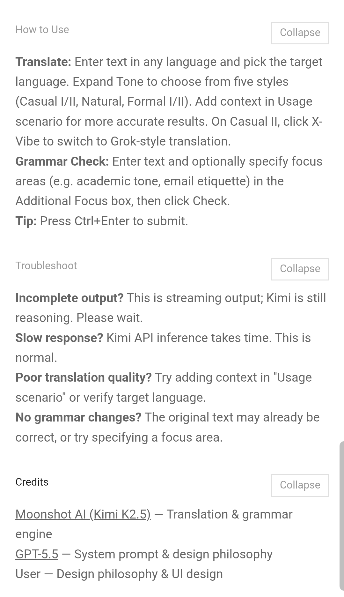
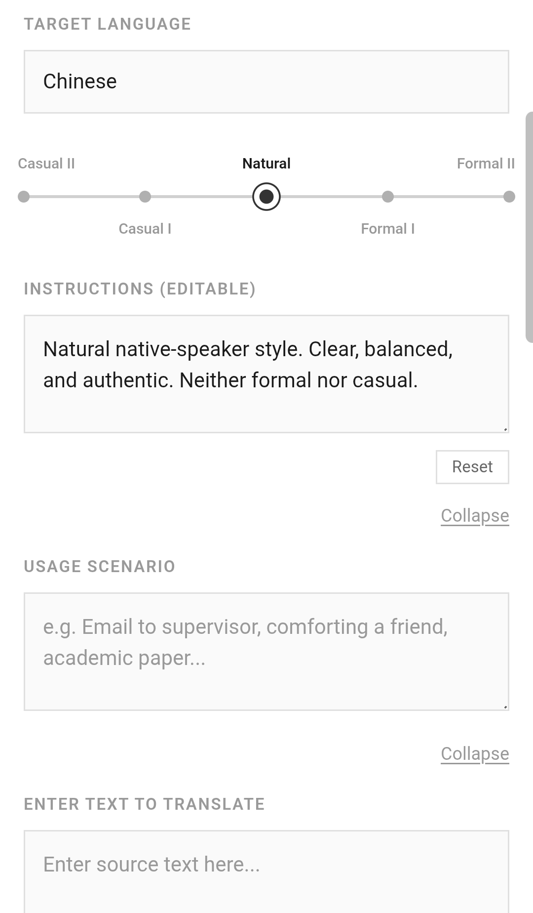
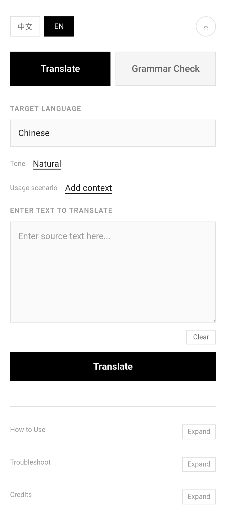
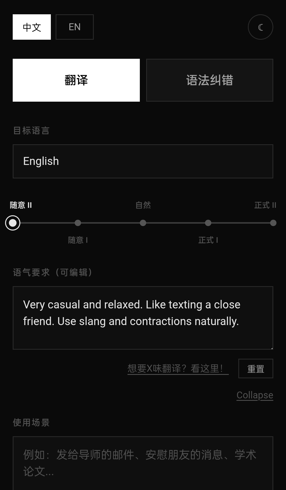
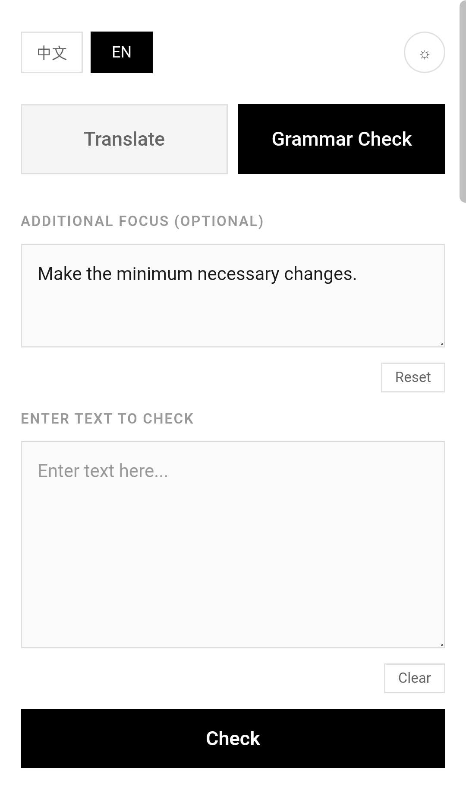

## "Kimi Translator"is now"PM Translator"!

(copyright issues...)

*this page was polished by Kimi

<details>
<summary>中文版</summary>

一个简洁的在线翻译与语法纠错工具，基于 Moonshot API + xAI Grok API + Cloudflare Pages 实现。

核心思路是：你可以直接写提示词，要求模型怎么翻译，或者着重检查哪些语法问题。

~~虽然说和自己打开 Kimi/Grok app 问没多大区别~~

---

```
09/05/2016 小修改: 翻译所用模型
K2.5在8月31日下线，故改为K2.6
```

```
07/29/2026 更新：v2.3
新增术语列表（不止能放术语，类似人名意译这种也行）
新增翻译历史和retry按钮	
再次稳定了Grok
```

```
07/24/2026 更新：v2.2 
1. 新增Target language专属输入框，Tone 和 Usage scenario 分家，且默认在界面上折叠
2. 优化了提示词，有其针对 v2.1 中 Grok 偶尔抽风的毛病。
3. 更新了脚注。
```

`07/17/2026 更新：V2.1 — 接入 Grok API，Casual II 档位支持一键切换 "X vibe" 模式`

`07/11/2026 更新：V2 — UI 调整，语气档位从 3 档扩展至 5 档（Casual I/II、Natural、Formal I/II），新增 Troubleshoot 手风琴和等待动画`

`05/30/2026 更新：增加了流式输出和优化了语法纠错过于苛刻的问题`

---

### 功能

- **多语翻译**：支持任意语言互译。目标语言会根据界面语言预填：中文界面默认译为英文，英文界面默认译为中文；也可以自行改为日语、法语等其他语言。
- **语法纠错**：修正语法和拼写，同时尽量保留原有语气与风格。可以在“额外要求”中指定检查重点。
- **语气档位**：预设有五种语气（随意 I / 随意 II / 自然 / 正式 I / 正式 II），每个档位的提示词都可以直接编辑。
- **使用场景**：补充上下文（如“发给导师的邮件”“安慰朋友的消息”），让翻译更贴合情境。
- **"X vibe" 模式**：在 Casual II 档位下，点击“想要 X 味翻译？看这里！”会调用 Grok 模型，输出更地道、更有网络感的 casual 翻译。

另外还支持双语界面、夜间模式、响应式布局、流式输出、Ctrl+Enter 快捷提交等。

</details>

---

Two main features: multilingual translation and grammar correction.

Built using Moonshot API, xAI Grok API, and Cloudflare Pages.

The key idea is that you can write prompts to specify exactly how you want things translated or what grammar issues to focus on.

~~Though it's not that different from just opening the Kimi/Grok app and asking~~

---

```
September 5th, 2026 tiny fix: change the model
K2.5 was discontinued on August 31st.
Switched to K2.6.
```

```
July 29th, 2026 Update: v2.3
1.Added a glossary list (not just for terms. also works for charactor names)
2.Added translation history and a retry button
3.Stabilized Grok again
```

```
Jul 24th,2026 Update: v2.2
1. Added Target language input and split Tone and Usage scenario into separate fields—both now collapse by default.
2. Refined the prompts, specifically addressing Grok stability issues from v2.1.
3. Updated footnotes.
```

`Jul 17, 2026 Update: V2.1 — Added xAI Grok API integration. Casual II tone now supports one-click "X vibe" mode.`

`Jul 11, 2026 Update: V2 — UI refinements, tone presets expanded from 3 to 5 (Casual I/II, Natural, Formal I/II), added Troubleshoot accordion and loading animation.`

`May 30, 2026 Update: Added streaming output and fixed the grammar checker being overly strict.`

---

### Features

- **Translation**: Supports any-language translation. The target language is prefilled based on UI language: Chinese UI defaults to English, English UI defaults to Chinese. You can also change it to Japanese, French, etc.
- **Grammar Check**: Fixes grammar and spelling while preserving the original tone and style. Optional focus areas can be specified.
- **Tone Presets**: Five editable tones (Casual I / Casual II / Natural / Formal I / Formal II).
- **Usage Scenario**: Add context (e.g. "email to supervisor", "comforting a friend") for more accurate translations.
- **"X vibe" Mode**: On Casual II, click "want that X vibe?" to switch to Grok for a more authentic, internet-style casual translation.

Also includes bilingual UI, dark mode, responsive design, streaming output, Ctrl+Enter quick submit, etc.

---

### Screenshots(v2.2 screenshots)

|  |  |  |  |  |
| :---: | :---: | :---: | :---: | :---: |
| footnote | expand | default | Chinese mode | grammar |

Latest UI demo (no API hooked up, just the interface>: https://pm-demo.translator-5ry.pages.dev/

---

### License

MIT License
MIT 协议

---

### Credits / 鸣谢

- [Moonshot AI](https://www.moonshot.cn) (Kimi K2.5) — Translation & grammar engine
- [xAI](https://x.ai) (Grok) — "X vibe" casual translation engine
- GPT-5.5 — System prompts & design philosophy
- User — Design philosophy & UI design

---

<details>
<summary>Deployment Guide / 部署指南</summary>

`Kimi 写的——我懒得改了`
`A deployment guide by Kimi, written specifically for beginners`

## 技术栈 / Tech Stack

| 层级 / Layer | 技术 / Technology |
|:---:|:---:|
| 前端 / Frontend | Vanilla HTML + CSS + JS |
| 后端 / Backend | Cloudflare Pages `_worker.js` |
| AI 接口 / AI API | Moonshot Kimi API (`kimi-k2.5`) + xAI Grok API (`grok-4.20-0309-non-reasoning`) |

## 部署 / Deployment

### 1. 准备文件 / Prepare Files

```
your-project/
├── _worker.js        # 后端 API 代理 / Backend API proxy
├── translator.html   # 前端界面 / Frontend interface
├── i18n.js           # 国际化 / i18n
├── style.css         # 样式 / Styles
├── index.html        # 现有主页（可选）/ Your existing homepage (optional)
├── loading2.svg      # Grok 模式的等待动画 / Loading animation for Grok mode
└── thinking.svg      # 普通等待动画 / Normal loading animation
```

### 2. 上传到 Cloudflare Pages / Upload to Cloudflare Pages

1. 打开 [Cloudflare Dashboard](https://dash.cloudflare.com) → Pages → Create a project
2. **上传文件** / **Upload your files**（拖拽上传 / drag & drop）
3. 点击部署 / Deploy

### 3. 设置环境变量 / Set Environment Variables

Pages Project → Settings → Environment variables:

| 变量 / Variable | 值 / Value |
|:---:|:---:|
| `KIMI_API_KEY` | 你的 Moonshot API 密钥，以 `sk-` 开头 / Your Moonshot API key (starts with `sk-`) |
| `GROK_API_KEY` | 你的 xAI API 密钥 / Your xAI API key |

### 4. 设置兼容性日期 / Set Compatibility Date

Pages Project → Settings → Functions → Compatibility date:

- 生产环境 / Production: `2026-05-14`（或最新可用日期 / or latest available）

保存后重新部署 / Save and redeploy.

### 5. 访问 / Visit

```
https://your-project.pages.dev/translator.html
```

</details>
