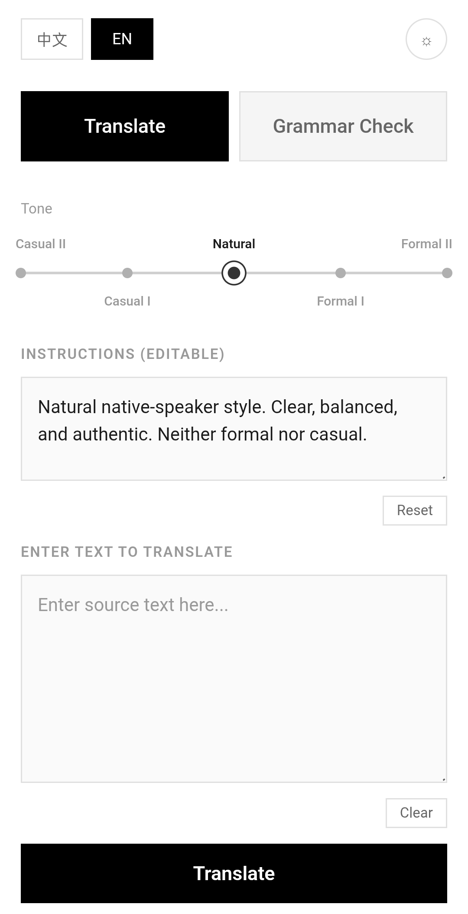
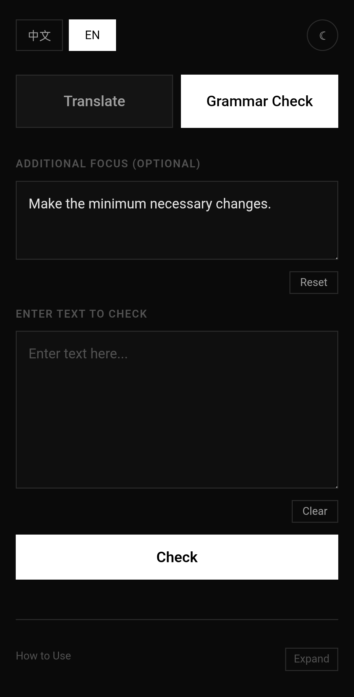

<details>
<summary>中文版</summary>

两个功能：多语翻译 和 语法纠错，详见下文。
Moonshot API + Grok API + Cloudflare Pages 实现。
我认为最重要的是可以直接写提示词要求怎么翻译/着重检查什么语法。
~~虽然说和自己打开 Kimi/Grok app 问没多大区别~~

---

`07/17/2026 更新：V2.1 — 接入 Grok API，Casual II 档位支持一键切换 "X vibe" 模式`

`07/11/2026 更新：V2 — UI 调整，语气档位从 3 档扩展至 5 档（Casual I/II、Natural、Formal I/II），新增 Troubleshoot 手风琴和等待动画`

`05/30/2026 更新：增加了流式输出和优化了语法纠错过于苛刻的问题`

---

### 功能

- **翻译**：默认中译英，翻译成其他语言需要自己在自定义要求那里指定。预设有五种语气：随意 I / 随意 II / 自然 / 正式 I / 正式 II
- **语法纠错**：修正语法和拼写，同时保留原有语气与风格。也可以指定要求。
- **"X vibe" 模式**：在 Casual II 档位下，点 "想要X味翻译？看这里！" 会得到Grok翻译，语气更野。

还有双语界面、夜间模式、响应式界面、流式输出、Ctrl+Enter 快捷提交什么的

</details>

---

Two main features: multilingual translation and grammar correction. Check the details below.

Built using Moonshot API, Grok API, and Cloudflare Pages.

I think the key thing is you can just write prompts to specify exactly how you want things translated or what grammar to focus on.

~~Though it's not that different from just opening the Kimi/Grok app and asking~~

---

`Jul 17, 2026 Update: V2.1 — Added Grok API integration. Casual II tone now supports one-click "X vibe" mode.`

`Jul 11, 2026 Update: V2 — UI refinements, tone presets expanded from 3 to 5 (Casual I/II, Natural, Formal I/II), added Troubleshoot accordion and loading animation.`

`May 30, 2026 Update: Added streaming output and fixed the grammar checker—it was getting way too picky.`

---

### Features

- **Translation**: Defaults to Chinese-to-English, but you can specify other languages in the custom settings. Five preset tones: Casual I / Casual II / Natural / Formal I / Formal II.
- **Grammar Check**: Fixes up grammar and spelling while keeping the original tone and style. You can also throw in specific requests.
- **"X vibe" Mode**: On Casual II, click "want that X vibe?" to switch to the Grok for a rawer, more vibe-heavy casual translation.

And there's bilingual interface, dark mode, responsive design, streaming output, Ctrl+Enter quick submit, etc.

---

### Screenshots / 页面截图

| ☀️ | 🌙 |
|:-----------:|:-----------:|
|  |  |

---

### License

MIT License
MIT 协议

---

### Credits / 鸣谢

- Moonshot AI (Kimi K2.5) — Translation & grammar engine
- Moonshot AI (Kimi K2.6( — Code assistance
- xAI (Grok 4.20) — "X vibe" casual translation engine
- GPT-5.5 — System prompts & design philosophy

---

<details>
<summary>deployment guide / 部署指南</summary>

`Written by Kimi—I didn't feel like editing it`
`A deployment guide by Kimi, written specifically for beginners`

`Kimi 写的——我懒得改了`
`Kimi 写的部署指南，专门给新手看的`

## 技术栈 / Tech Stack

| 层级 / Layer | 技术 / Technology |
|:---:|:---:|
| 前端 / Frontend | Vanilla HTML + CSS + JS |
| 后端 / Backend | Cloudflare Pages `_worker.js` |
| AI 接口 / AI API | Moonshot Kimi API (`kimi-k2.5`) + xAI Grok API (`grok-4.20-0309-non-reasoning`) |

## 部署 / Deployment

### 1. 准备文件 / Prepare Files

```
your-project/
├── _worker.js        # 后端 API 代理 / Backend API proxy
├── translator.html   # 前端界面 / Frontend interface
├── i18n.js           # 翻译 / i18n
├── style.css         # 样式 / Styles
├── index.html        # 现有主页（可选）/ Your existing homepage (optional)
├──loading2.svg       # Grok模式的等待动画 / Loading animation for Grok mode
└──thinking.svg       # normal loading animation
```

### 2. 上传到 Cloudflare Pages / Upload to Cloudflare Pages

1. 打开 [Cloudflare Dashboard](https://dash.cloudflare.com) → Pages → Create a project
2. **上传文件** / **Upload your files**（拖拽上传 / drag & drop）
3. 点击部署 / Deploy

### 3. 设置环境变量 / Set Environment Variables

Pages Project → Settings → Environment variables:

| 变量 / Variable | 值 / Value |
|:---:|:---:|
| `KIMI_API_KEY` | 你的 Moonshot API 密钥，以 `sk-` 开头 / Your Moonshot API key (starts with `sk-`) |
| `GROK_API_KEY` | 你的 xAI API 密钥 / Your xAI API key |

### 4. 设置兼容性日期 / Set Compatibility Date

Pages Project → Settings → Functions → Compatibility date:

- 生产环境 / Production: `2026-05-14`（或最新可用日期 / or latest available）

保存后重新部署 / Save and redeploy.

### 5. 访问 / Visit

```
https://your-project.pages.dev/translator.html
```

</details>
