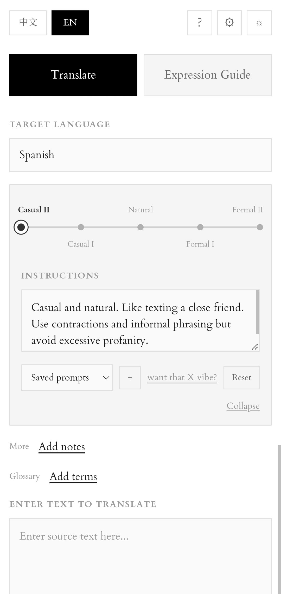
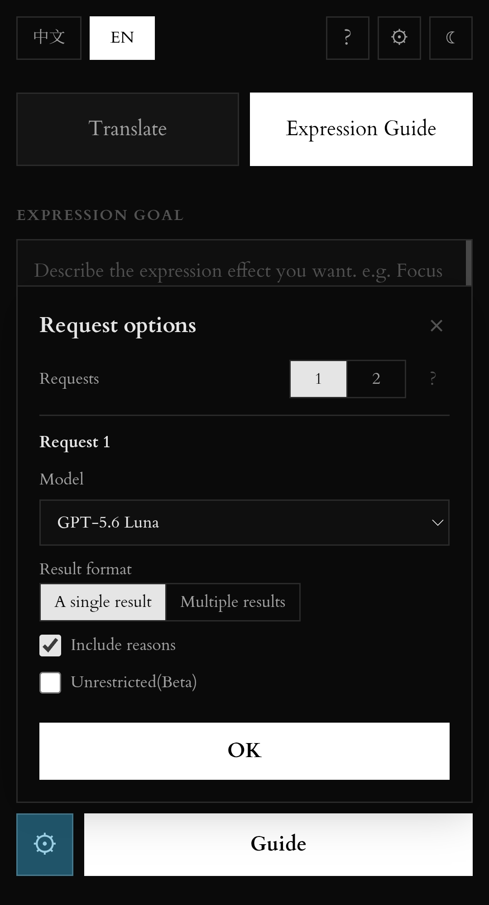

中文版

为解决许多翻译器不能指定如何翻译的问题，pm_translator 的特色是可以自己说明要求、调整语气、指定方向重试。同时有一个“表达指导”，可以和模型简单地对话，以调整自己的表达措辞

## 目前功能（v2.5.1）

### 通用功能：
1.设置自己的API KEY
注：我这边是完全看不到的，我又没有数据库存用户记录。它是用浏览器缓存在本地保存的。
2.历史记录和常用prompt保存
3.指定一次产生多少个结果、调用什么模型和是否需要翻译/修改的理由
注：页面顶部的教程是旧版本的，还没写好，下次会修。

### Translator(翻译器)主要有：
1.指定语气
  有随意到正式的5个档位，也可以自己改
2.其他要求
  有别的什么要求，或者想说明语用场景可以写在这里
3.术语表
  指定不用翻译、或者有特定译法的词句

### Expression Guide(表达指导)主要有：
1.指定自己想要达到的表达效果，或者只修语法
2.与AI展开简短的对话，如果你对它的修改有疑问可以提出来。

## 页面截图（部分功能）

| day | night |
| :---: | :---: |
|  |  |

可以在这里直接使用PM Translator：https://translator-5ry.pages.dev/translator

注：还没有默认的Anthropic API KEY，调用Claude时要先自己设置API KEY，在页面顶部。

Most translation tools give me a translation, but not much control over how it’s phrased...

So PM Translator lets you describe what you want, adjust the tone, retry with specific instructions, etc. It also includes an Expression Guide, where you can have a simple chat with the model to come up with the best wording.

## Current Features (v2.5.1)

### General features

1. Bring Your Own Key
   You can set your own API key.
   🟢Note: I can’t see them at all because I don’t have a database storing user info😇. They're saved locally in your browser cache.

2. Save translation history and frequently used prompts

3. Choose how many results to generate, which model to use, and whether to include reasons for the translation or edits
   ‼️Note: The tutorial at the top of the page is from an older version and hasn’t been updated yet. I’ll fix it next time.

### *Translator* features

1. Choose the tone
   From casual to formal. 5 tones. You can customize them too.

2. More (=additional requirements)
   Put any other requirements here, or describe the context if you like.

3. Glossary
   Specify words or phrases that shouldn’t be translated, or that should use a particular translation.

### Expression Guide features

1. Describe the kind of expression you’re aiming for, or just ask it to fix the grammar.

2. Have a short conversation with the AI
   If you’re not sure about its edits, just ask about it.

## some screenshots

| day | night |
| :---: | :---: |
|  | 

🟢You can use PM Translator here!:https://translator-5ry.pages.dev/translator

⚙️Note: No default Anthropic API key yet. If you want to use Claude, set your own API key (at the top of the page).

